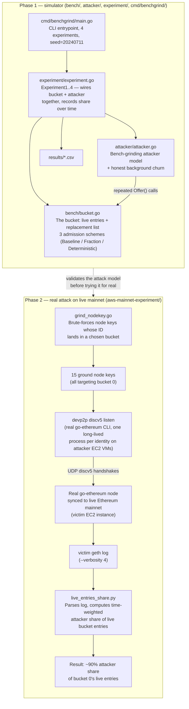

# Ethereum Eclipse Defense — Project Overview

**Project:** Hardening Ethereum Against Eclipse Attacks
**Student:** Archa · M.Tech Cyber Security, Amrita Vishwa Vidyapeetham

## 1. What is the project?

Our project focuses on protecting Ethereum against **Eclipse Attacks**.

An attacker tries to fill a victim's peer-discovery bucket with
attacker-controlled nodes and push honest backup nodes out.

## 2. Two phases of the project

**Phase 1 — Simulator**
- Recreated the attack using Go.
- Tested three admission methods.
- Compared how well each method prevents attackers from filling the
  replacement list.

**Phase 2 — Real Ethereum Mainnet**
- Tested against a real Ethereum node on AWS.
- Used 15 attacker identities.
- Achieved around 90% attacker occupancy in one bucket.

See [`aws-mainnet-experiment/`](aws-mainnet-experiment/) for the full
writeup of Phase 2.

## 3. What's here

| Package | Role |
|---|---|
| [`bench/`](bench/) | The bucket: live entries + replacement list, three admission schemes |
| [`attacker/`](attacker/) | The bench-grinding attacker + honest background churn model |
| [`experiment/`](experiment/) | The four experiments, producing CSV output |
| [`cmd/benchgrind/`](cmd/benchgrind/) | CLI: runs all four experiments, writes results to `results/` |
| [`aws-mainnet-experiment/`](aws-mainnet-experiment/) | The real attack: node-key grinding + live-share measurement against a real geth node on mainnet |

## 4. Architecture



Phase 1 is entirely self-contained Go, no network calls — `cmd/benchgrind`
wires `experiment/` to `bench/` and `attacker/` and writes CSVs. Phase 2 is
real infrastructure: `grind_nodekey.go` is the only custom attacker code,
everything else in the attack path (`devp2p discv5 listen`, the victim
node) is real go-ethereum running on AWS, and `live_entries_share.py` is
the only custom code on the measurement side, reading the victim's own log.

## 5. What is a replacement list (bench)?

Each Kademlia bucket has:
- **16 live entries:** nodes currently used by the routing table.
- **10 replacement entries:** backup nodes waiting to enter when a live
  node is removed.

The vulnerability is that attackers can repeatedly insert nodes and push
honest backup nodes out. This was checked directly against the real
go-ethereum source (`p2p/discover/table.go`), not reimplemented from the
project brief's description:

```go
bucketSize      = 16  // live entries per bucket
maxReplacements = 10  // replacement list ("bench") size per bucket
bucketIPLimit   = 2   // max nodes from the same /24 subnet, per bucket
tableIPLimit    = 10  // max nodes from the same /24 subnet, whole table
```

Two behaviours confirmed against the real source and reproduced exactly:
- **`pushNode`** inserts a new node at the **front** and evicts from the
  **back** once the replacement list is full — the rule a grinding
  attacker exploits.
- **`deleteInBucket`** promotes a **uniformly random** replacement into
  the live entries, **not** newest-first (an earlier iteration of this
  project incorrectly assumed newest-first; corrected after cross-checking
  the real source).

## 6. Three defense methods

| Method | How it works | Grinding helps the attacker? |
|---|---|---|
| **Baseline** | Current geth behaviour: front-insert / evict-back, /24 limit only | Yes, substantially |
| **Fraction Sampling** | Randomly accepts only some incoming nodes | Slightly — throttles both attacker and honest traffic equally |
| **Deterministic Placement** | Assigns nodes to fixed slots based on subnet + a secret | No — repeated insertion of the same node is a no-op |

**Best result:** deterministic placement makes repeated insertion
ineffective.

## Requirements

- Go ≥ 1.22 (no external dependencies for the simulator — `bench/`,
  `attacker/`, `experiment/`, and `cmd/benchgrind/` use only the Go standard
  library)
- For the real-mainnet phase in `aws-mainnet-experiment/`: Go ≥ 1.22 plus
  `github.com/ethereum/go-ethereum` as a module dependency, and a synced
  go-ethereum node to attack (see that folder's README for setup)

## Quick start

```bash
go build ./...
go test ./...                    # 18 tests across bench/ and attacker/
go run ./cmd/benchgrind           # runs all four experiments, writes results/*.csv
```

That's it on default settings — four experiments run end to end in a few
seconds and the numbers below are what you should see. All randomness is
seeded (`SEED = 20240711`); every run is reproducible.

## Advanced usage

`cmd/benchgrind` takes one flag:

```bash
go run ./cmd/benchgrind -out myresults    # write CSVs to myresults/ instead of results/
```

The experiment parameters themselves (number of attacker subnets, insertion
rate, honest churn rate, round counts, the 0.9 "reached" threshold in
Experiment 3) are not exposed as CLI flags — they're set directly in
`cmd/benchgrind/main.go` where each experiment is called, e.g.:

```go
// cmd/benchgrind/main.go, line 25
e1 := experiment.Experiment1ReproduceGrind(5, 20, 200, seed)
//                                          ^  ^   ^    ^
//                               attacker subnets=5, insertion rate=20,
//                               rounds=200, seed=20240711
```

To try a different attack configuration — e.g. fewer attacker subnets, or a
faster/slower insertion rate — edit the arguments on the relevant
`experiment.ExperimentN...` call and re-run `go run ./cmd/benchgrind`. Each
experiment function's parameters are documented in
[`experiment/experiment.go`](experiment/experiment.go).

For the real-mainnet attack's parameters (target bucket, number of ground
identities, measurement window), see
[`aws-mainnet-experiment/README.md`](aws-mainnet-experiment/).

## 7. Main experiment results (seed 20240711)

- **Baseline:** attacker can fill the replacement list quickly — bench
  share converges to 1.000 unopposed, settles to 0.500 under sustained
  honest churn.
- **Fraction Sampling:** settles to 0.600 under churn, and rejects **51.4%**
  of honest admission attempts along the way — it can't tell attacker
  traffic from honest traffic, so it throttles both.
- **Deterministic Placement:** settles to 0.333 under churn, rejects
  **0%** of honest attempts in the tested setup, and its cost to the
  attacker (~127 rounds to reach 90% share) stays flat **no matter how
  fast the attacker grinds** — unlike baseline and sampling, which both
  collapse toward 1 round as insertion rate increases.

Full per-experiment tables (all four experiments, every insertion rate
tested) are kept in [`experiment/`](experiment/) and reproduced by running
`go run ./cmd/benchgrind` yourself (see Quick start above).

## What the tests verify

`bench/bucket_test.go` (11 tests): capacity bounds, subnet-limit enforcement
under every scheme, front-insert/back-evict ordering, the core grind
(baseline bench eventually fully attacker-controlled), fraction sampling
requiring strictly more insertions than baseline for the same share,
deterministic grinding being a genuine no-op (1000 repeated insertions ==
1 insertion), the attacker's deterministic-scheme occupancy being capped by
actual distinct hash-slot count (not a naive ratio — collisions among
honest seed subnets are accounted for), and promotion being uniformly
random rather than newest-first (verified statistically across 2000 trials).

`attacker/attacker_test.go` (7 tests): end-to-end attack trajectories across
all three schemes, unopposed vs. sustained-churn scenarios, the
deterministic-vs-baseline and deterministic-vs-sampling advantage holding
under averaging, monotonicity of attacker cost with insertion rate, and
reproducibility under a fixed seed.

## 8. Current limitations

- The defense (deterministic placement) has only been tested in the
  simulator. It has not yet been implemented in real go-ethereum and
  tested against the live Ethereum node — the AWS phase confirms the
  **attack**, not the defense, over the wire.
- Deterministic placement's zero honest-overhead result reflects 40
  distinct honest subnets contending for 10 slots with no attacker
  present; it does not yet model the secret changing (e.g. on restart) or
  adversarial subnet selection aimed at specific honest subnets.
- The simulator models one bucket's admission/promotion dynamics, not the
  full 256-bucket table, DNS-based peer discovery, or connection-slot
  occupation — those are separate attack surfaces (see Shi et al., WWW
  2026) outside this project's scope.
- Pure identity-flooding likely tops out well below 90% in buckets with
  heavy honest traffic, since slots there only open when an existing
  honest entry fails its own liveness check — reasoned from the mechanism,
  not yet confirmed as a controlled experiment; see
  `aws-mainnet-experiment/README.md`.

## Next steps

- Patch the deterministic-placement scheme into a modified `table.go`,
  rebuild geth, and confirm the defense holds against a real bench-grinding
  attacker over the wire against the same live-mainnet victim used in
  `aws-mainnet-experiment/` (requires Go ≥ 1.24 for current go-ethereum).
- Plotting code for the four simulator experiments' CSV output (the
  real-mainnet phase already has its own plotting script, see
  `aws-mainnet-experiment/`).
- A "negative control" run confirming a high-traffic bucket resists pure
  identity flooding even with the listen-mode fix applied.

## Main takeaway

Our project demonstrates an Ethereum peer-discovery vulnerability and
evaluates three ways to defend against it. The real AWS experiment
confirms the attack, while the simulator shows that deterministic
placement is the most promising defense among the three tested methods.
